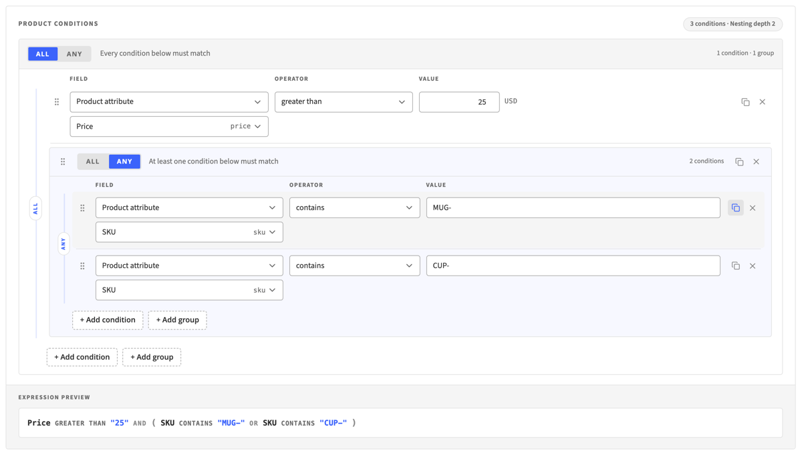

# Magento 2 & Adobe Commerce UI Form Elements

Reusable `ui_component` **admin form** elements. Sibling to
`hryvinskyi/magento2-configuration-fields`, which does the same job for **system configuration** fields.



## Description

Magento ships a fixed set of `formElement` types for ui_component forms. This module adds elements that
several modules would otherwise each reinvent, and owns their JS, Knockout templates, CSS and the shared
back-end services in one place so consuming modules depend on shared infrastructure rather than on each
other.

## Elements

### Expression builder

A condition builder for ui_component forms — the modern alternative to Magento's legacy rule widget.
That widget is bound to `Magento\Framework\Data\Form`: it renders itself by building `Data\Form\Element`
objects and returns them as an HTML string, it expects the flat `1--1`-style form-POST shape on the way
back, and it has no ui_component counterpart at all. There is no way to drop it into a ui_component form,
which is why forms that need conditions either fall back to an old-style admin block or grow their own
builder. This element is that builder, once.

#### Files

| Path | Role |
|---|---|
| `view/adminhtml/web/js/form/element/expression-builder.js` | the Knockout component — presentation only |
| `view/adminhtml/web/js/form/element/expression-*.js` | the modules the component delegates to, one concern each: the pure rules, and the pointer drag's DOM adapter `expression-drag.js` (see [Module layout](#module-layout)) |
| `view/adminhtml/web/js/expression-builder/mount.js` | the public mount: renders the builder into any element of an admin page, outside a form (see [Mounting outside a form](#mounting-outside-a-form)) |
| `view/adminhtml/web/js/expression-builder/mount-options.js`, `value-sync.js` | the mount's pure rules: which options pass and the registry name, and when a value is reported or loaded |
| `types/mount.d.ts` | TypeScript declaration of the public mount, under its RequireJS id |
| `view/adminhtml/web/template/form/element/expression-builder.html` | the element's outer template |
| `view/adminhtml/web/template/form/element/expression-group.html` | one group, recursing into child groups |
| `view/adminhtml/web/template/form/element/expression-preview.html` | one preview node, recursing likewise |
| `view/adminhtml/web/css/expression-builder.css` | styles — every class and custom property is prefixed `ufe-`; the palette reads the admin UI kit's tokens |
| `view/adminhtml/layout/hryvinskyi_ui_form_elements_expression_builder.xml` | the layout handle a form page asks for: the kit's stylesheet, then the builder's |
| `Api/ExpressionBuilderConfigInterface` | the contract a consuming module implements |
| `Api/*` + `Model/*` | the shared back-end services (see [Shared PHP services](#shared-php-services)) |

**The component knows nothing about any consumer's domain.** Field labels, attribute codes, wording and
semantic rules all arrive through the config contract. `product_attribute_picker` and the
`'product-attribute'` value type are the component's *own* vocabulary and stay. No test checks this
by reading the source; it is kept in review, and the JS suite runs the pure modules with neutral
fixtures.

#### Serialisation contract

The field value is **one JSON string** holding a nested Magento condition tree —
`{type, attribute, operator, value, is_value_processed, aggregator, conditions: [...]}` — which is what
`Magento\Rule\Model\Condition\Combine::asArray()` produces. Hydrate it with
`$rule->getConditions()->loadArray($tree)`. Do **not** use `AbstractModel::loadPost()`: that runs
`_convertFlatToRecursive()`, which expects the flat `1--1` form-POST shape and will mangle a nested tree.

Property order in the emitted Combine nodes is fixed, and load → save over an untouched rule is
byte-identical, so opening a form does not mark it dirty. A root left without any conditions serialises
to `''`, the field's "no rule" value.

Byte-identity holds across a PHP round-trip too, which takes two deliberate carry-throughs, because
`Magento\Rule\Model\Condition\AbstractCondition` does not read back everything it writes:

- it emits `is_value_processed` from a flag it *reads* under the different key `is_value_parsed`, so
  every leaf a PHP save has touched comes back carrying `false` where a freshly authored one carries
  `null` — the component echoes whatever a leaf was loaded with instead of emitting a constant;
- `Condition\Product\AbstractProduct::loadArray()` pushes the value of a decimal-backed attribute
  through a locale number parse, so a `"100"` an editor typed is re-encoded **unquoted** — the
  component writes an unquoted value back unquoted for as long as the row still holds exactly that
  number, and falls back to the string shape on the first real edit.

One documented exception: a rule the admin **cleared** does not survive a PHP round-trip unchanged.
`Combine::asArray()` omits the `conditions` key entirely when the Combine has no children, so a stored
childless root loads as an empty rule and re-serialises to `''` rather than to the stored JSON. That is
the intended value for "no rule" — but a consumer that re-serialises through PHP (as the rule model's
`beforeSave()` does) stores the childless Combine object instead, and the two spellings of "empty" are
not byte-equal. Nothing downstream distinguishes them: both hydrate to a Combine with no children.

#### Nested groups

The authored expression is a **recursive group tree**, 1:1 with the stored Combine tree: a group *is* a
Combine node, carrying an `all` / `any` aggregator and any mix of condition rows and child groups, to
arbitrary depth. Aggregators live on groups, never on rows, so reordering never rewrites them.

Because the model is recursive rather than two-level, **any stored shape loads losslessly** — a legacy
disjunctive-normal-form tree (an `any` root of `all` Combines) round-trips byte-identical, and a nested
Combine under an `all` root loads as the nested group it is instead of being silently dropped.

Authoring depth is capped by the `maxGroupDepth` tunable (shipped value **5**, the outermost group
counting as level 1). One value backs every path that can nest: the "+ Add group" action is offered only
while `depth < maxGroupDepth`, and both reorder paths — pointer drop and arrow-key move — refuse any slot
where `slotDepth + heightOf(movedNode) > maxGroupDepth`, so dragging a three-deep group cannot smuggle
nesting past the cap. A refused slot is simply not a candidate: no indicator appears, and the arrow-key
walk steps over it to the next reachable gap. The cap is a UX limit, deliberately well below the
server-side hydration guard (`ConditionTreeValidatorInterface::DEFAULT_MAX_DEPTH`, 10 node levels), so a
rule that authors cleanly always saves.

Template recursion goes through Magento's Knockout template-name mechanism with an explicit
`{group, builder, depth}` data object. Every call to the component reads `builder.…` at a distance fixed
by the template's own structure, never `$root` and never a counted `$parents` chain — which is what makes
the same template correct at every nesting level.

#### `builderConfig` keys

The config object is passed to the field as an `xsi:type="object"` argument and encoded into the field's
JS config through `jsonSerialize()`. Every key has a constant on
`Hryvinskyi\UiFormElements\Api\ExpressionBuilderConfigInterface`.

| Key | Constant | Required | Absent behaviour |
|---|---|---|---|
| `combineType` | `COMBINE_TYPE` | yes | reads as `''`, so the tree serialises with an empty Combine `type` and nothing hydrates |
| `fields` | `FIELDS` | yes | reads as `[]` — the Field dropdown is empty, and a row added anyway matches no field descriptor and serialises to nothing |
| `suggestUrl` | `SUGGEST_URL` | no | no value autocomplete: the type-ahead resolves to an empty list without requesting anything |
| `suggestMinQuery` | `SUGGEST_MIN_QUERY` | no | falls back to the component's own `suggestMinQuery` tunable (2) |
| `emptyStateMessage` | `EMPTY_STATE_MESSAGE` | no | the preview renders nothing when no condition has been added |
| `coherence` | `COHERENCE` | no | no field is gated and no warning is ever shown |
| `countUrl` | `COUNT_URL` | no | **no match-count badge exists and no count is ever requested** |
| `countLabel` | `COUNT_LABEL` | no | the badge shows the bare number (also when the supplied text has no `%1`) |
| `countStoreId` | `COUNT_STORE_ID` | no | `0` — all websites. Junk and negative values also read as `0` |
| `optionsUrl` | `OPTIONS_URL` | picker | no attribute option list can ever arrive, so optioned picker attributes degrade to the free-text editors — see [On-demand attribute options](#on-demand-attribute-options) |
| `operatorSets` | `OPERATOR_SETS` | no | attribute `operatorSet` names resolve to nothing and those attributes fall back to their field's operator list |

There is deliberately **no default for `emptyStateMessage`**: an empty rule means *match everything* to a
targeting consumer and *select nothing* to a filtering one, so a shared default would be wrong for half
its users. `coherence` and `countUrl` follow the same philosophy — a consumer that cannot express the
semantics, or cannot count its matches, omits the key rather than getting a wrong default.

##### Field descriptor schema

`fields` is a list of descriptors. These are the keys the component actually reads:

| Key | Type | Meaning |
|---|---|---|
| `type` | string | the condition class written into the serialised node, or the literal `product_attribute_picker` |
| `childType` | string | picker only: the concrete condition class written for each chosen attribute |
| `label` | string | what the admin sees in the Field dropdown (already translated) |
| `attribute` | string | the condition's attribute code; omitted for the picker. Also a `coherence.requirements` lookup key |
| `valueType` | string | `text` \| `select` \| `multiselect` \| `product-attribute` — which value editor renders |
| `operators` | list | `{value, label}` entries offered for this field; `list: true` on an entry makes its value a list, like `()`/`!()` |
| `options` | list | `select`/`multiselect`: `{value, label}`, optionally `+ {level, parent}` (see below) |
| `attributes` | list | picker only: the attribute descriptors |
| `placeholder` | string | free-text editor placeholder (already translated); absent → none |
| `unit` | string | shown beside the field's value editor, saying what the number is entered in (a currency or weight code — codes are never translated); absent → no unit element |
| `scalarType` | string | pins the **default advisory validator** for this field's scalar editor |

An **operator entry** may carry two further keys:

| Key | Meaning |
|---|---|
| `validate` | name of a registered validator applied to the row's value while this operator is selected. Built-ins: `regex`, `number`, `integer`, `float`, `email`, `not-empty`. An unregistered name validates nothing and shows nothing — a stale config degrades silently |
| `validateMessage` | already-translated text shown when that validation fails; without it the component's built-in message for the validator is used |

Validation is **advisory only**. A failing value renders a hint under the editor and is still serialised
and saved — the admin may be mid-typing, so it is never a save gate. A row whose value is still **empty**
and that no validator faults gets the built-in completion nudge the same way ("Enter a value to complete
this condition." / "Pick at least one value to complete this condition.") — informational, never a gate,
and a consumer wiring `not-empty` on an operator outranks it: the empty value fails that validator, and
its message, before the nudge is consulted.

An **attribute descriptor** (the picker's `attributes` entries — what
`ProductAttributeMetaProviderInterface::getAttributes()` returns) carries:

| Key | Meaning |
|---|---|
| `value` | attribute code |
| `label` | what the admin sees in the Attribute dropdown |
| `inputType` | EAV frontend input; feeds the scalar-type resolution below |
| `hasOptions` | whether a finite pickable option list exists at all — the list itself is fetched from `optionsUrl` on demand (see below). A descriptor may still carry an inline `options` list, which the component uses as-is and never fetches for |
| `suggest` | whether the consumer's suggest endpoint accepts this code |
| `operatorSet` | name of a shared set in the config's `operatorSets` map, or `null` to fall back to the field's own list. An explicit `operators` array pinned on a descriptor outranks the name |
| `unit` | what the attribute's number is entered in, shown beside its value editor — the meta provider emits the base currency code for `price`-input attributes and the configured weight unit for `weight`-input ones, `''` otherwise |
| `scalarType` | optional; pins both the scalar editor **and** its default validator (see below). The meta provider emits `float` for numeric-backed text attributes — the client used to infer that from a `>=` entry in the embedded operator array, and named sets left nothing to sniff |

##### On-demand attribute options

Attribute descriptors deliberately ship **without their option lists**. A catalog can carry hundreds of
optioned attributes and thousands of options (this project's carries ~700 and ~3,500), and embedding
every list front-loaded each form with megabytes of JSON for the one or two lists an admin actually
opens. Instead, the moment an optioned attribute (`hasOptions`) is selected — or a stored rule renders
one — the component requests `optionsUrl?attribute=<code>` once, shows a "Loading values…" placeholder
in the value column meanwhile, and writes the answered list into the descriptor, after which every
option editor behaves exactly as if the list had been inline. Per code, per form, at most one request:
in-flight requests are de-duplicated and a failed fetch is not retried — that row degrades to the
option-less editors, which can at least hold a typed value. A request with no answer after 15 seconds
counts as failed (see [Requests](#requests)). The endpoint answers `{options: [...]}`
via `AttributeOptionsProviderInterface`, whose normalisation is byte-identical to what descriptors used
to embed, so a rule authored against a lazily-loaded list serialises exactly as it always did.

Field-level `options` (a dedicated Category field, a select field) stay inline: fields are few and
consumer-curated — the picker is the unbounded surface. This is also what de-duplicates the category
tree, which used to be embedded twice per form (once by the dedicated field, once by the picker's
`category_ids`).

##### Long option lists: the searchable single-select

A single-choice list too long to scan renders as a **searchable combobox** instead of a `<select>`. Three
controls use it:

* the picker's **Attribute** control, always — that list is the catalogue's whole attribute set;
* any `select`-valueType field's **value** control, once its option list is longer than
  `searchableSelectThreshold` (15). At or below the threshold the plain `<select>` stays, and it is the
  better control there: one keystroke opens it and the browser owns its keyboard behaviour. Field and
  Operator are single-choice lists too and are deliberately never converted — they hold a handful of
  entries each;
* an optioned attribute's **value** control on a Product Attribute row, under the same threshold judged
  per selected attribute — a three-option colour keeps the native control while a brand list escalates,
  and the option ids beneath the labels are what tell two same-named entries apart. (Its multi-value
  operators already had the searchable pills editor.)

Closed, the control is one line: the chosen option's **label** as the input's value, with its **code**
beside it in muted type (and referenced as the input's `aria-describedby`, so it is announced as well as
shown). The whole face is one click target, like the `<select>` it replaces: a click on the code, the
chevron or the padding focuses the input — and focusing is what opens the list, so there is no second
open path. Open, the input holds the query and each entry is two lines — label, then code. The code is not a
nicety: an attribute list carries several entries with the *same* label, differing only in the prefix of
their code, and a native `<option>` can show nothing but its label, so picking the right one was guesswork.

Search matches every whitespace-separated token against the label **or** the code, case-insensitively —
so `brand` finds all four attributes labelled "Brand", and `dock brand` (or `dock_brand`) narrows to one.
Matches come back **ranked**, because with hundreds of entries the first few rows are all anyone reads:

| rank | match |
|---|---|
| 1 | the query IS the code |
| 2 | the label starts with the query |
| 3 | the code starts with the query |
| 4 | the label contains the query |
| 5 | the code contains the query |
| 6 | every token was found, but the query as typed is in neither — which is what a two-word query narrowing label *and* code looks like |

Ties keep the option list's own order, so an alphabetical list stays alphabetical inside each rank. The
ranking is pure and node-tested (`expressionOptions.optionSearch`), and the result honours the same
`optionMatchCap` and the same truncation hint as every other dropdown. Choosing an entry does exactly what
the `<select>` did — for the Attribute control that means resetting the operator and clearing the value —
so a rule authored through the new control serialises byte-identically.

##### Option shapes: flat and tree

An option entry is `{value, label}`. Add `level` and `parent` and the picker becomes a **collapsible
tree**: `level` is the hierarchy depth (level 1 = a root), `parent` is the parent's `value` (`''` for a
root). Hierarchy is detected on the first entry's `level` key — flat lists keep the plain filtered-list
behaviour everywhere, so nothing has to be migrated.

Labels stay plain: hierarchy is never baked into them. Typing switches the dropdown from the tree to a
flat match list whose entries and whose pill tooltips show the full breadcrumb path, and the search
matches any option whose path contains every whitespace-separated token — so naming an ancestor plus a
fragment of the leaf finds an otherwise ambiguous leaf.

A tree row reads left to right as **expand caret, checkbox, label, count badge**, indented by its level:

| part | behaviour |
|------|-----------|
| the row | toggles selection — click to select, click again to deselect. Only the node's **own** value is stored; descendants are never added for it, so what a listed value covers below itself stays the consuming rule's decision |
| the caret | expands/collapses this branch only, and stops the click from reaching the row — expanding never selects. A leaf renders the same box empty, so the columns line up |
| the checkbox | checked when the value is stored, **partially selected** (a dash) when the node itself is not stored but something below it is, empty otherwise — the Lucide `square-check` / `square-minus` / `square` glyphs, inlined as CSS mask data URIs (no network request, and the colour still comes from the theme tokens). Decorative (`aria-hidden`): the row is the option and its `aria-selected` is what announces the state. The partial state is also spelled out in the row's `title`, so it is not carried by colour alone |
| the count badge | how many entries sit below this one, at any depth; leaves show none. Its `title` names what the number counts |

Above the list, a header row offers **Expand all** and **Collapse all** for the whole tree and states how
many values the row currently stores — the pills spelling them sit above the dropdown, outside a scrolled
branch's view. Below it, the panel's footer says what a click does in the current mode and offers a
pointer-only **Done** that closes the list (the keyboard's way out remains `Escape`). Expand-all
renders every node at once, so it is withdrawn when the option list is larger than `treeExpandAllLimit`
(200 by default, retunable per field) and Collapse-all's tooltip then says why; collapsing is never
withdrawn, since it only removes rows.

**Breadcrumb paths and subtree counts are derived client-side** by walking the `parent` chain
(`expression-options.js` builds the index once per option list, in a single pass, and caches it on the
descriptor). **There is no `pathLabels` key and no server-side path map**: `level` + `parent` fully
determine every path, while a precomputed map would add hundreds of kilobytes to every payload that
carries the option list, on a multi-thousand-category catalog. An
option whose `parent` is not in the list renders at the top level and its breadcrumb stops where the
chain breaks.

The partially-selected state is computed from the stored value **upward**: each stored value's ancestors
are credited once per render, so the whole list costs (stored values × depth) and never a subtree walk
per rendered row.

##### `coherence`

Optional semantic rules. Shape:

```php
self::COHERENCE => [
    'contextAttribute'     => 'my_context_code',
    'contradictionWarning' => (string)__('These context conditions contradict each other.'),
    'requirements'         => [
        // key = a field's `type` OR its `attribute` (both are looked up)
        'my_dependent_field_type' => [
            'contexts' => ['a_context_value'],
            'warning'  => (string)__('This condition needs a context condition in the same group.'),
        ],
    ],
],
```

A field named in `requirements` is offered in a row's Field dropdown only when the row's *conjunctive
scope* — the conditions guaranteed to hold alongside it through its `all`-ancestors, including the
closure through nested `all`-sibling groups — holds a context condition targeting one of its `contexts`.
`any`-joined branches never borrow each other's context rows. The currently-selected field always stays
visible, so an existing row remains editable. A field absent from `requirements` is always selectable,
which is exactly why **a consumer with no context field must omit `coherence` entirely** — otherwise its
own fields would be gated behind a field its form never offers. Warnings are prefixed with the group's
depth-first number once more than one group exists, and every string arrives already translated.

#### Component tunables (`defaults`)

`defaults` is the framework's override surface, so each of these can be retuned per field from the form
XML without touching this module.

| Tunable | Shipped | Meaning |
|---|---|---|
| `maxGroupDepth` | `5` | how deeply groups may nest, outermost group = 1. Read by the "+ Add group" guard and by both reorder paths |
| `optionMatchCap` | `100` | maximum matches an options-based dropdown lists. The truncation hint interpolates this very number, so cap and wording cannot drift |
| `treeExpandAllLimit` | `200` | largest option list the tree's "Expand all" is offered for. Above it the action is withdrawn — expanding every node of a catalogue-sized list renders it all at once — and Collapse-all's tooltip names this number |
| `searchableSelectThreshold` | `15` | longest option list a single-choice `select` field still renders as a plain `<select>`. Above it the field escalates to the searchable combobox (see below). Not consulted for the picker's Attribute control, which is always searchable |
| `pillCollapseLimit` | `15` | pills rendered before a multi-value editor collapses the rest behind a `+N more` toggle |
| `pasteNoticeTimeout` | `4000` | how long (ms) the paste report stays under the pills |
| `suggestMinQuery` | `2` | shortest query sent to the suggest endpoint, and the threshold below which "no matches" stays unsaid |
| `suggestDebounce` | `250` | idle time (ms) before a keystroke turns into a suggest request |
| `countDebounce` | `600` | idle time (ms) before an edit turns into a match-count request |
| `joinerStyle` | `'rail'` | how the joining of a group's children is drawn: `rail` runs a tinted line down the group's left edge carrying the aggregator word, `chip` spells the word between every two children, `none` keeps only the separator lines. One treatment for the whole builder |
| `density` | `'comfortable'` | vertical rhythm of the condition rows; `compact` tightens the row padding for forms that embed the builder among a lot of chrome |
| `showPreview` | `true` | whether the preview block — structured preview, match-count badge, warnings — renders at all |

Override them in the field's config array:

```xml
<item name="config" xsi:type="array">
    <item name="component" xsi:type="string">Hryvinskyi_UiFormElements/js/form/element/expression-builder</item>
    <item name="template" xsi:type="string">Hryvinskyi_UiFormElements/form/element/expression-builder</item>
    <item name="optionMatchCap" xsi:type="number">50</item>
    <item name="pillCollapseLimit" xsi:type="number">30</item>
</item>
```

**Junk degrades, it never breaks.** Every tunable is sanitised once on init: anything that is not a
positive finite number falls back to the shipped value in `defaults` (which instance config cannot
reach), because the alternative is a `NaN` travelling into a `slice()` bound, a `setTimeout` delay or a
query-length threshold — blanking a dropdown or stalling the type-ahead with no error anywhere.
`countStoreId` is the one exception to the *positive* rule: `0` is a meaningful store id ("not scoped to
one store"), so it is sanitised to a non-negative integer instead. The string tunables (`joinerStyle`,
`density`) are constrained to their known values the same way — anything outside the set degrades to the
shipped value rather than to a modifier class no stylesheet defines — and `showPreview` reads as `true`
for anything but boolean `false`.

`suggestMinQuery` has a further rule: a `builderConfig.suggestMinQuery` **outranks** both the shipped
default and any XML override of it. The endpoint answers nothing below its own minimum, so a client
querying under it would render "no matches" for input the backend never looked at.

#### Value types and validators — the two extension seams

Scalar value editors are **registry data**, not template branches. One generic editor renders every
scalar type, taking its native input attributes from the type's registry entry.

Built-in value types:

| Name | Native input attributes | Default validator | Transforms |
|---|---|---|---|
| `text` | `type="text"` | — | — |
| `integer` | `type="number" step="1" inputmode="numeric"` | `integer` | — |
| `float` | `type="number" step="any" inputmode="decimal"` | `float` | — |
| `date` | `type="date"` | — | display truncates a stored `Y-m-d H:i:s` to `Y-m-d`; nothing is written back |
| `time` | `type="time"` | — | — |
| `email` | `type="email" inputmode="email"` | `email` | — |

Built-in validators: `regex`, `number`, `integer`, `float`, `email`, `not-empty`. The format validators
(`regex`, `number`, `integer`, `float`, `email`) **pass blank input** by design, mirroring native HTML5
validation semantics — they judge the format of present input only, so a pristine editor shows no error.
Flagging emptiness is exclusively `not-empty`'s job.

**Type resolution order** (`expressionValue.scalarTypeFor`):

1. an explicit `scalarType` on the descriptor wins outright;
2. the EAV frontend input maps directly — `date`/`datetime` → `date`, `int` → `integer`,
   `price`/`weight`/`decimal` → `float`;
3. a `>=` entry in the descriptor's own operator set reads as `float`, which catches a decimal- or
   int-backed attribute whose frontend input is plain text;
4. everything else — a missing descriptor included — is `text`.

An unknown type name falls back to the `text` definition rather than blanking the editor, so a mixin that
failed to load still leaves a usable free-text input.

**Message precedence** on a failing value: the operator entry's `validateMessage` → the component's
built-in message for that validator → the generic `Invalid value`. A consumer-registered validator is
therefore never silently messageless.

##### Registering your own — a complete example

Both registries are open through a RequireJS **mixin** on the pure value module, with no edits to this
module. Declare the mixin in your own module's
`view/adminhtml/requirejs-config.js`:

```js
var config = {
    config: {
        mixins: {
            'Hryvinskyi_UiFormElements/js/form/element/expression-value': {
                'Acme_Module/js/expression-value-mixin': true
            }
        }
    }
};
```

`view/adminhtml/web/js/expression-value-mixin.js` — the mixin receives the module's export object,
mutates it and **hands it back**. Returning the target is mandatory: Magento's mixin loader assigns
`target = mixin(target)` with no fallback, so a mixin that forgets its `return` replaces the module with
`undefined`. Because the loader rewrites every dependency name, the component receives the already-mixed
object and needs no knowledge of your module:

```js
define([], function () {
    'use strict';

    /**
     * @param {Object} expressionValue The Hryvinskyi_UiFormElements value module.
     * @returns {Object} The same module.
     */
    return function (expressionValue) {
        // A validator is a pure (value) -> Boolean predicate. Blank input passes: presence is the
        // `not-empty` validator's job, and a pristine editor must not show a format error.
        expressionValue.registerValidator('ean13', function (value) {
            if (value === null || value === undefined || String(value).trim() === '') {
                return true;
            }

            return /^\d{13}$/.test(String(value).trim());
        });

        // A value type is data plus at most two tiny transforms. `attrs` is mandatory — a definition
        // without a plain `attrs` object is ignored, as is a blank name or a non-function predicate,
        // so broken third-party input can never clobber a built-in with something uncallable.
        expressionValue.registerValueType('ean13', {
            attrs: {type: 'text', inputmode: 'numeric', maxlength: '13'},
            validator: 'ean13',
            commitValue: function (input) {
                return String(input).replace(/\D+/g, '');
            }
        });

        return expressionValue;
    };
});
```

Then name them from your PHP config. A validator is named by an operator entry:

```php
['value' => '==', 'label' => __('is'), 'validate' => 'ean13'],
```

A value type is named by `scalarType`. Note the asymmetry, because it is easy to trip over: the generic
scalar editor renders in the **attribute picker's** value column, so a `scalarType` on a picker
*attribute* descriptor selects both the editor and its default validator, while a `scalarType` on a
*field* descriptor selects only the default validator (the field keeps its `valueType` editor).
`ProductAttributeMetaProviderInterface::getAttributes()` does not emit `scalarType`, so add it to the
descriptors you want to pin:

```php
$attributes = $this->productAttributeMetaProvider->getAttributes($rawOptions, $suggestableCodes);

foreach ($attributes as &$attribute) {
    if ($attribute['value'] === 'my_ean_attribute') {
        $attribute['scalarType'] = 'ean13';
    }
}
unset($attribute);
```

Registering an existing name overwrites it — that is deliberate, so a consumer may re-skin a built-in
type (give `date` a different editor, say) rather than only add to the set.

#### Keyboard map

| Context | Key | Effect |
|---|---|---|
| any dropdown | `ArrowDown` | move the highlight down; from nothing, onto the first entry; on a closed dropdown, re-opens it |
| any dropdown | `ArrowUp` | move the highlight up; off the first entry, back to the typed text; from the typed text, wrap to the last entry |
| any dropdown | `Enter` | commit the highlighted entry |
| any dropdown | `Escape` | close the dropdown (collapses the tree, drops the highlight); passes through when already closed |
| any dropdown | `Home` / `End` | jump to the first / last entry — **only** once a highlight exists, so the caret keys still work while typing |
| any dropdown | any key that edits the text | drops the highlight, which pointed into the list the previous query produced. The keys listed here, `Tab` and the bare modifiers are exempt, because pressing them changes no text |
| option tree | `ArrowRight` / `ArrowLeft` | expand / collapse the highlighted parent; only a parent in the state the key would change reacts, otherwise the key moves the caret |
| option tree | `Enter` on a collapsed parent | expands it instead of selecting it — one keystroke, one obvious effect |
| option tree | `Space` | toggles the highlighted node's selection, both ways — the keyboard's equivalent of clicking the row, and the only way to deselect from the keyboard, since `Enter` on a collapsed branch is spoken for by expansion. Taken over only in the tree, which has no search text, so a space typed into a breadcrumb query still separates its tokens |
| free-text pill input | `Enter` with nothing highlighted | commits the typed text as a pill |
| other value editors | `Enter` with nothing highlighted | swallowed — those editors take values from the list, and an unhandled `Enter` inside an admin form submits it |
| pill input | paste containing `,` `;` tab or newline | split into trimmed entries and appended as pills; text without a separator is pasted normally |
| drag handle | `ArrowUp` / `ArrowDown` | move the node one insertion slot up / down, skipping slots the depth cap refuses; at either end nothing moves and the key is still consumed |
| during a pointer drag | `Escape` | cancels the drag (document-level listener, removed with the drag) |

Focus and announcements. A dropdown list swallows `mousedown` on its container, so the bound input keeps
focus through the whole click: every entry commits on `click`, the list never closes underneath the
pointer, and picking several values in a row keeps it open. Each dropdown carries the combobox/listbox
ARIA contract — `role="combobox"` with `aria-autocomplete="list"`, `aria-expanded`,
`aria-controls`/`aria-activedescendant` addressing component-generated entry ids, `role="listbox"` on the
list and `role="option"` with `aria-selected` on the entries. The advisory rows — the loading state, the
"No matches" verdict and the truncation hint — are rendered from state rather than from the navigable
list and carry `aria-disabled="true"`, so the keyboard walks exactly the entries that can be committed.
Every icon-only button — carets, pill removals, duplicate, remove, drag handles — has an accessible name
that says what it acts on. Tree entries additionally carry `aria-level`, and `aria-expanded` only where a
subtree actually exists. Every live region is **polite**: the structured preview, the warning list, the
match-count badge, each multi-value editor's paste report and the reorder status. Each is rendered from
first paint and hidden while empty, because a region inserted together with its first message is
announced only by chance — and polite because all of them speak while the admin is still typing. After a
keyboard move, focus returns to the handle and the reorder region reports the node's new position in
insertion slots, which is the only thing a reorder changes that is otherwise invisible.

#### Match-count badge

A consumer that can count what its rule selects supplies `countUrl`; the component then shows a debounced
badge above the preview. **Omit `countUrl` and the badge does not exist and nothing is ever requested** —
it is a property of the config, not a state the badge can fall into.

The component POSTs form-encoded `conditions` (the serialised tree, exactly the field value), `store_id`
(from `countStoreId`) and `form_key` to that URL, with `X-Requested-With: XMLHttpRequest` and
same-origin credentials. The endpoint answers `{count: int, capped: bool}` on success or `{error: true}`
when the tree cannot be counted. The badge shows the number with thousands grouped by a non-breaking
space, plus a trailing `+` when `capped` is true; `countLabel`'s `%1` is replaced with that text, and a
label without `%1` degrades to the bare number.

**The cap lives server-side.** The component never names a threshold: it renders "more than this many"
from the number and the flag that arrived, so retuning the endpoint's cap needs no change here. An empty
tree resolves locally to the badge's silent `idle` state — no request — because consumers disagree on
what "no conditions" selects. Every failure mode (non-OK status, a body that is not JSON, a rejected
fetch, no answer within 15 seconds, `{error: true}`, a missing or non-numeric count) renders as
*unavailable* rather than as zero: "nothing matches" and "the count could not be produced" must not look
alike. Overlapping requests are safe — an edit aborts the count request in flight, and an aborted
request's answer is never shown — and an unchanged tree costs no request at all.

#### Requests

The component sends three kinds of request: the match count, a row's value suggestions, and an
attribute's option list. All three follow the same rules (`expression-requests.js`):

- **A newer request aborts the one it supersedes.** A new tree aborts the count in flight; a new query
  in a row — or one too short to ask about — aborts that row's suggest request. An aborted request's
  answer is never written, so a slow answer to an older question cannot replace the current one.
- **Every request has a 15-second deadline** (`REQUEST_DEADLINE` in `expression-requests.js`, a module
  constant rather than a tunable). Past it the request is aborted and fails like any broken response:
  the badge shows *Count unavailable*, the row's value column falls back to the option-less editors, the
  suggestion list empties.
- **`destroy()` aborts every request in flight**, and the component starts no request after it. A
  field the form discards and rebuilds — a modal closing, a dynamic-rows entry removed — receives no
  late answers.

#### Shared PHP services

`etc/di.xml` maps each contract to its implementation. Consumers depend on the `Api/` interfaces only.

**`ProductAttributeMetaProviderInterface`** — hand it the raw `code => label` map a rule condition's
`loadAttributeOptions()` reports plus the suggester's whitelist, and it returns the enriched descriptor
list the picker's `attributes` key consumes: EAV input type, whether an option list exists
(`hasOptions` — never the list itself), the NAME of the per-input-type operator set, the suggest flag,
and the unit a number is entered in (the base currency code for `price`-input attributes, the
configured weight unit for `weight`-input ones). Deliberately reads no source models: describing 700
attributes must not cost 700 option reads.

**`AttributeOptionsProviderInterface`** — the on-demand half of the above: one attribute's normalised
option list (`category_ids` answering the tree-shaped category options), for the consumer's
`optionsUrl` endpoint to serve when the picker actually needs it. Defensive throughout — an unknown
code, a non-optioned input type or a broken source model answers `[]`, never an exception — so the
endpoint passes the result through unconditionally. Guarding WHICH codes may be asked belongs to the
endpoint, against the codes its own form can author. `category_ids` is special-cased (it is a synthetic
rule attribute, not an EAV one) to the tree-shaped category options with membership operators and no
suggest. A text-input attribute stored in a `decimal`/`int` backend column is judged as `decimal` for
operator purposes while its descriptor keeps reporting `text`. Every lookup is defensive: a missing
attribute or a throwing source model degrades that one attribute to free text instead of failing the
form.

**`OperatorSetPolicyInterface`** — the single source of the operator subsets offered per input type:

| Input type | Operators |
|---|---|
| `boolean` | `==` `!=` |
| `select` | `==` `!=` `()` `!()` |
| `multiselect` | `()` `!()` only |
| `price` / `decimal` / `weight` | `==` `!=` `>=` `>` `<=` `<` |
| `date` / `datetime` | `==` `>=` `<=` `>` `<` (no `!=`, matching Magento's own date rule forms) |
| anything else | `null` — the caller falls back to its field-level list |

`membership()` exposes the `()` / `!()` pair on its own, for a field that is inherently a membership
test. Multiselect is narrow on purpose: Magento's rule validators collapse equality and containment into
the same set-intersection check there, so offering more only misleads the admin into thinking the
operators behave differently.

**`CategoryTreeOptionsProviderInterface`** — every category below the invisible global root, ordered by
path so a parent always precedes its children, as `{value, label, level, parent}`. Plain names, no
indentation prefixes, no server-side breadcrumb map (see [Option shapes](#option-shapes-flat-and-tree)).

**`AttributeValueSuggesterInterface`** — the whole value-autocomplete lookup behind one service:
a construction-time whitelist of queryable attribute codes, a minimum query length, the `LIKE` query over
the product collection and the distinct-value folding. `suggest()` never throws — any internal failure
collapses to an empty list, so an endpoint can pass the result straight through. Two accessors exist so
the endpoint and the UI cannot drift: `getSuggestableCodes()` (published into the picker's `suggest`
flags) and `getMinQueryLength()` (published as `suggestMinQuery`).

The default preference resolves the interface to a suggester with an **empty** whitelist — every
`suggest()` call answers nothing. That is the fail-closed default; a consumer opts codes in with a
virtual type, and Magento resolves `<argument>` overrides by the constructor parameter **name** on the
concrete class, never by the interface a parameter is typed against. So every consuming class must type
the parameter as `AttributeValueSuggesterInterface` and name it `$attributeValueSuggester`, and **one**
virtual type feeds both the endpoint and the config block so their view of the whitelist is literally the
same object graph:

```xml
<!-- Acme/Module/etc/adminhtml/di.xml -->
<virtualType name="AcmeModuleAttributeValueSuggester"
             type="Hryvinskyi\UiFormElements\Model\AttributeValueSuggester">
    <arguments>
        <argument name="suggestableCodes" xsi:type="array">
            <item name="sku" xsi:type="string">sku</item>
            <item name="name" xsi:type="string">name</item>
        </argument>
    </arguments>
</virtualType>
<type name="Acme\Module\Controller\Adminhtml\Entity\SuggestAttributeValues">
    <arguments>
        <argument name="attributeValueSuggester" xsi:type="object">AcmeModuleAttributeValueSuggester</argument>
    </arguments>
</type>
<type name="Acme\Module\Block\Adminhtml\MyConditionsConfig">
    <arguments>
        <argument name="attributeValueSuggester" xsi:type="object">AcmeModuleAttributeValueSuggester</argument>
    </arguments>
</type>
```

A consuming class **without** such a `<type>` mapping silently receives the bare preference, and with it
the empty whitelist. `maxResults` (25) and `minQueryLength` (2) are constructor arguments too and can be
retuned the same way.

**`ConditionTreeValidatorInterface`** — the whitelist gate every hydration path must pass a tree through
before `loadArray()` sees it. `loadArray()` instantiates whatever class name each node's `type` carries,
and the field value is a documented public JSON contract that travels through form POSTs and a database
column, so a node naming a class outside the consumer's own declared set rejects the tree **as a whole**;
what "rejected" means is the caller's decision (keep the previously stored tree, hide the entity, return
no products, …). An empty tree is valid — it means "no rule authored" — and so is a childless root.

`allowedTypesFromConfig()` derives the allowed set from the same builder config that renders the form —
`combineType`, every field's `type`, every field's `childType`, skipping the component-vocabulary
`product_attribute_picker` because it never appears in a serialised tree — so the whitelist cannot drift
from what the UI can author. A consumer whose config build runs catalog queries should not build it on a
hot path, and the pattern for that is a dependency-free class constant pinned to the derived set by a
unit test:

```php
class MyConditionsConfig implements ExpressionBuilderConfigInterface
{
    /**
     * Condition classes this form can author. Kept dependency-free so the storefront path can read
     * it without building the whole config; a unit test pins it to allowedTypesFromConfig().
     */
    public const ALLOWED_CONDITION_TYPES = [
        \Magento\CatalogWidget\Model\Rule\Condition\Combine::class,
        \Magento\CatalogWidget\Model\Rule\Condition\Product::class,
    ];

    // … getConfig() / jsonSerialize() as in Usage below
}
```

```php
// every path that hydrates — save, load, storefront render, count endpoint
if (!$this->conditionTreeValidator->isValid($tree, MyConditionsConfig::ALLOWED_CONDITION_TYPES)) {
    return null; // or keep the stored tree / flag the entity — the caller's own policy
}
$rule->getConditions()->loadArray($tree);
```

The depth guard is the second half of the gate: nodes nested deeper than `$maxDepth` levels (the root is
level one, default `DEFAULT_MAX_DEPTH = 10`) invalidate the whole tree. It bounds the work of recursively
hydrating a hand-crafted payload — denial-of-service headroom, not a UX limit, which is why the authoring
cap sits far below it.

#### Usage

1. Implement the config contract in your module:

```php
class MyConditionsConfig implements \Hryvinskyi\UiFormElements\Api\ExpressionBuilderConfigInterface
{
    /**
     * @inheritDoc
     *
     * @return array<string, mixed>
     */
    #[\Override]
    public function jsonSerialize(): array
    {
        return $this->getConfig();
    }

    /**
     * @inheritDoc
     */
    #[\Override]
    public function getConfig(): array
    {
        return [
            self::COMBINE_TYPE      => \Magento\CatalogWidget\Model\Rule\Condition\Combine::class,
            self::SUGGEST_URL       => $this->backendUrl->getUrl('my_route/my_controller/suggestAttributeValues'),
            self::SUGGEST_MIN_QUERY => $this->attributeValueSuggester->getMinQueryLength(),
            self::EMPTY_STATE_MESSAGE => (string)__('No conditions — this rule selects nothing.'),
            self::FIELDS            => [/* field descriptors — see the interface docblock */],
        ];
    }
}
```

2. Declare the field in your form's ui_component XML:

```xml
<field name="my_conditions" formElement="input">
    <argument name="data" xsi:type="array">
        <item name="config" xsi:type="array">
            <item name="component" xsi:type="string">Hryvinskyi_UiFormElements/js/form/element/expression-builder</item>
            <item name="template" xsi:type="string">Hryvinskyi_UiFormElements/form/element/expression-builder</item>
            <item name="builderConfig" xsi:type="object">Acme\Module\Block\Adminhtml\MyConditionsConfig</item>
            <item name="additionalClasses" xsi:type="string">ufe-expression-field</item>
        </item>
    </argument>
    <settings>
        <dataType>text</dataType>
        <dataScope>my_conditions</dataScope>
    </settings>
</field>
```

A `<label>` in the field's settings is rendered as the builder's own heading. The standard Magento
label/control wrap stays suppressed either way: this element replaces the standard field template, so
that wrap would only reappear as a stray heading and an input wrap around a widget that is not an input.

3. Include the stylesheets: in the layout file of the form's page, ask for the module's handle.

```xml
<page xmlns:xsi="http://www.w3.org/2001/XMLSchema-instance"
      xsi:noNamespaceSchemaLocation="urn:magento:framework:View/Layout/etc/page_configuration.xsd">
    <update handle="hryvinskyi_ui_form_elements_expression_builder"/>
    …
</page>
```

The handle links the admin UI kit's stylesheet (`hryvinskyi/magento2-admin-ui`, a dependency of this
package), then `expression-builder.css`. The builder's root carries the kit's tokens-only root
(`hui-tokens`), and its colours, radii and typefaces read the kit's `--hui-*` tokens, so the builder
takes the kit's look and any theming of the kit's tokens on the page; its controls keep their own rules.
A page that still includes only the stylesheet, with a bare
`<css src="Hryvinskyi_UiFormElements::css/expression-builder.css"/>`, keeps working: every token falls
back to the Magento admin palette (greys, borders, 3px radii) and to the kit's blue accent
(`#3b63fb`); the 1.1 orange accent is gone. Accent tints (focus ring, rail, washes) follow the accent
in browsers with `color-mix()`; older browsers keep blue tints (`rgba(59, 99, 251, …)`).

A form rendered into a modal through `mui/index/render_handle` gets no `<head>` of its own, so its
layout cannot link a stylesheet. The page that hosts the modal asks for the handle instead.

4. The field posts a **single JSON string**. Decode it on save, run it through
   `ConditionTreeValidatorInterface::isValid()` against your `ALLOWED_CONDITION_TYPES`, and hydrate with
   `loadArray()`. Re-encode the stored tree on load, and validate again on every path that hydrates it —
   the posted tree and the stored tree are two different trust boundaries. Treat an emptied builder
   (`''`) as "clear the conditions", not as "no change", or targeting can never be removed once set.

5. Provide the two AJAX endpoints. The **options endpoint** (`optionsUrl`) delegates to
   `AttributeOptionsProviderInterface` and guards the `attribute` param against the codes your form can
   author — without it, optioned picker attributes degrade to free text. The **autocomplete endpoint**
   delegates to `AttributeValueSuggesterInterface` with the whitelist wired as shown above — never let
   an arbitrary attribute code reach a collection filter. If you can count what your rule matches, add
   a `countUrl` endpoint answering `{count, capped}` with a server-side cap.

#### Mounting outside a form

A page that is not a ui_component form — a Preact island, a plain admin template — mounts the builder
through `Hryvinskyi_UiFormElements/js/expression-builder/mount`:

```js
require(['Hryvinskyi_UiFormElements/js/expression-builder/mount'], function (api) {
    var handle = api.mount(host, {
        value: storedRule,             // the stored rule as JSON, '' for none
        builderConfig: builderConfig,  // what your ExpressionBuilderConfigInterface publishes
        label: 'Only when',            // any tunable from the table above; nothing else
        joinerStyle: 'rail'
    }, function (value) {
        // each value an edit in the builder produces
    });

    handle.setValue(otherRule);        // show another rule
    handle.destroy();                  // dispose the builder and remove what it rendered
});
```

`mount(host, options, onChange)` returns `{setValue(value), destroy()}`:

- **Where it renders.** The builder is created the way a form creates it — the layout processor
  instantiates the component under a registry name and Magento's `scope` binding renders its template —
  into an element of its own appended to `host`; the host's attributes and other children stay yours.
  The call is safe at any time once the host exists, before or after `DOMContentLoaded`. The builder is
  created a moment later, once RequireJS has the component.
- **Options.** `value` (a string) and `builderConfig` (an object) are required; `name` picks the registry
  name (a letter, then letters, digits, `_` or `-`; one already in use is refused), and without it a free
  one is generated. The tunables of [Component tunables](#component-tunables-defaults) and `label` (the
  heading) may be set. Any other key — a misspelt tunable, or a framework key such as `template` or
  `provider` that would wire the builder into a form that is not there — throws a `TypeError` naming it.
- **One builder per host.** Mounting into a host that already holds one returns the handle it has; the
  first call's options and callback stay in force until that handle is destroyed.
- **`onChange`** hears each value an edit produces, once. It never hears the value the builder was given —
  at mount or through `setValue` — nor the builder's rewrite of that value into its own serialisation
  (key order, number formats), so a caller that marks its document dirty on each report does not turn
  dirty when it opens.
- **`setValue`** loads a different value and rebuilds the rule. The value the builder already holds, the
  last edit it reported, and the raw value last handed in are ignored, so passing the same value on every
  render does not rebuild the rule under the person editing it. A call before the builder exists is
  applied once it does.
- **`destroy`** disposes the builder (computeds, timers, requests in flight, a drag in progress), cleans
  and removes the element it rendered into, and frees the registry name. It is idempotent, and safe
  before the builder exists: the builder is disposed as it arrives.

The page still needs the stylesheets: the kit's `admin-ui.css` and `expression-builder.css` (the layout
handle above, or the page's own way of loading styles).

**TypeScript.** `types/mount.d.ts` declares the module under its RequireJS id. Add the file to your
compilation (`files` or `include` in the tsconfig, or a triple-slash reference) and import the types with
`import type`, which leaves nothing behind in your bundle; load the module through the page's RequireJS:

```ts
import type {
    ExpressionBuilderHandle,
    ExpressionBuilderMountModule
} from 'Hryvinskyi_UiFormElements/js/expression-builder/mount';

type RequireMount = (
    dependencies: readonly ['Hryvinskyi_UiFormElements/js/expression-builder/mount'],
    loaded: (module: ExpressionBuilderMountModule) => void,
    failed: (error: Error) => void
) => void;
```

The declaration types `builderConfig` as `Readonly<Record<string, unknown>>`: the component reads and
checks it itself, so it is passed through as the server sent it. It holds no `any`.

The Knockout component itself has one public method for this: `loadStoredValue(value)` replaces the
authored rule with the one a stored value describes, after clearing the pending timers and any drag of
the rows it replaces.

**The tree follows the field value.** A value written into the field from outside after the builder was
created — a form's `reset()` back to the initial value, `clear()`, a provider value that reaches the field
through its link after `initialize()` — is loaded into the tree the same way. A write is outside when it
is neither the tree's own serialisation nor `loadStoredValue()`'s own write, so the builder's auto-save
never reloads the tree and a load cannot loop.

## Module layout

The front end splits by concern into dependency-light AMD modules — never a util grab-bag. No module but
the component imports Knockout or `mage/translate`, touches a global or sends a request, so each one runs
under plain Node; the two that drive the platform (`expression-requests.js`, `expression-drag.js`) are
handed it as an argument.

- **`expression-tree.js`** — tree structure and serialisation *only*: tree ⇄ recursive group model,
  the stored field value ⇄ the model (malformed JSON loads empty, a rule with no condition saves as
  `''`), conjunctive closure and scope, group enumeration, node movement, insertion slots, subtree height
  and condition count, what a group directly holds, the aggregator a nested group starts on,
  contradiction solving. Depends on `underscore`.
- **`expression-value.js`** — leaf values: value shapes between storage and editor, pasted-list parsing,
  the value-type and validator registries, which validator a value fails, and the scalar editor's rules
  (whether a row is in a scalar context, whether it renders the scalar editor or keeps the type-ahead,
  what it shows and stores, what an empty editor still needs). No dependencies.
- **`expression-options.js`** — option lists: parent/child maps, breadcrumb paths, subtree sizes, path and
  flat search with their cap, what a list-valued editor still offers, the bare label of a chosen option.
  No dependencies.
- **`expression-config.js`** — the consumer's `builderConfig` with every documented key present, the
  tunables sanitised (and the values the visual ones may take), the fields indexed by type. No
  dependencies.
- **`expression-fields.js`** — what a field descriptor says about a row: the picked attribute, the
  operators offered, a fresh row's defaults and what it carries over when its field or attribute
  changes, the unit, where the row's options come from, and whether a single value is picked from the
  plain `<select>` or the searchable combobox. No dependencies.
- **`expression-condition.js`** — one stored leaf ⇄ the state of its row, byte-identical on an unchanged
  rule; a row whose field is not configured drops out of the saved rule. Depends on `expression-fields`,
  `expression-value`.
- **`expression-coherence.js`** — which fields a row may pick, and the rule's contradiction and
  missing-context warnings. Depends on `expression-tree`, `expression-value`, `expression-fields`.
- **`expression-reorder.js`** — where a node may move: the depth cap (shared with the add-group action),
  the slot walk, a keystroke's step, where each gap is measured and which is nearest to the pointer, where
  the drop indicator sits, the announced position. Depends on `expression-tree`.
- **`expression-listbox.js`** — the dropdowns' rules: the keyboard pattern (a key → one action), which
  variant a row's open list is (searchable single-select, option tree, type-ahead, flat list), whether
  the tree or the type-ahead feeds it, the variant registry (what a commit does — Enter on a collapsed
  parent expands it, the type-ahead replaces or appends — whether picking adds to a list, whether the
  open list is on screen), who owns the open list, what a value editor does with a key the pattern left
  alone, and what a closed searchable select shows. Depends on `expression-options`.
- **`expression-option-tree.js`** — the hierarchical picker's view state: visible nodes, partly-selected
  counts, expansion maps, breadcrumb labels, the size limit of "Expand all", what toggling a node does.
  No dependencies.
- **`expression-list-value.js`** — editing a list value: de-duplicated appends, removal, pill collapse,
  clear-all, typed text, what the offer leaves out, a paste planned and resolved against the options.
  Depends on `expression-options`, `expression-value`.
- **`expression-preview.js`** — the structured preview's shape, which label each token takes, and how a
  value prints. Depends on `expression-fields`.
- **`expression-count.js`** — the match-count badge: whether the consumer counts at all, when to ask,
  what to post, how to read the answer, how to print the number. No dependencies.
- **`expression-remote-options.js`** — the attribute-option and value-suggest endpoints: when each is asked
  (one option request per attribute, none after a failure), the URL, how the answer is read, when the
  type-ahead has something to show. No dependencies.
- **`expression-requests.js`** — the requests' lifecycle: which request a newer one supersedes, the
  15-second deadline, aborting everything on teardown, and whether an answer may still be written. The
  abort controllers and timers it drives are handed in. No dependencies.
- **`expression-drag.js`** — the one adapter beside the component: a pointer drag's DOM work (the handle's
  pointer capture, the Escape listener, measuring rendered nodes by id). The document is handed in, so it
  runs under Node against a recording document. Where a node may go stays in `expression-reorder.js`. No
  dependencies.
- **`expression-builder/mount-options.js`** — what the public mount passes to the component (the stored
  value, the builder config and the documented tunables; any other key refused by name) and the registry
  name it creates the builder under. No dependencies.
- **`expression-builder/value-sync.js`** — when a mounted builder's value is reported to its caller and when
  a value the caller hands in is loaded, so neither direction echoes. No dependencies.
- **`expression-builder/mount.js`** — the public mount, an adapter: it binds the two modules above to the
  layout processor, the registry and Knockout.
- **`expression-builder.js`** — the Knockout component, **presentation only**: observables, the members
  the templates bind, focus, timers, sending the requests, the pointer drag's state. It asks the modules
  above for every decision and applies the answer. Every user-facing phrase lives here (or arrives
  already translated from a consumer's config); the other modules carry no wording at all.

The PHP side follows the repo's convention: contracts in `Api/`, implementations in `Model/`, wired in
`etc/di.xml`. There are no Helper classes and no `ObjectManager` calls.

## Testing

**JS.** Every module but the component has behavioural tests that run on **plain Node**, with no
Magento bootstrap, no `npm install` and no build step. The request lifecycle runs against Node's own
`AbortController` and a timer the test fires by hand, the drag adapter against a recording document and
drag handle. The suite loads each module from its real path, in
dependency order, and hands a module the real siblings it depends on, so a moved or renamed module fails
it:

```
node app/code/Hryvinskyi/UiFormElements/Test/Js/run.mjs
```

Run it from the repo root; it prints one line per suite and exits non-zero on failure. The public mount's
two pure modules (`mount-options.js`, `value-sync.js`) run there too. The Knockout component and the mount
itself are not run there: they depend on browser-only Magento AMD modules
(`Magento_Ui/js/form/element/abstract`, `ko`, `mage/translate`, `uiLayout`, `uiRegistry`). The browser
suite below runs them.

**Browser.** `Test/Js/browser/` renders the real component in Chromium, driven by Playwright. A static
harness page loads it the way an admin form does — Magento's own RequireJS from `lib/web`, the module
configs of Magento_Theme, Magento_Translation and Magento_Ui, Knockout, jQuery, underscore, Magento_Ui's
Knockout bootstrap with its template engine and bindings (`scope`, `i18n`), `mage/translate` with a
translation dictionary, `uiLayout`, `uiRegistry` and Magento_Ui's abstract form element — and renders the
three templates from this module's working copy. A small Node server started by the tests serves it on
`127.0.0.1` and a free port; no store, database or static-content deploy is involved, and nothing beyond
localhost is contacted. The one stand-in is the network: the page's `fetch` records each request and
answers only when a test says so, which is how a test delivers an answer after `destroy()`. The server
finds Magento's `lib/web` in the nearest ancestor directory of the module, or in `MAGENTO_ROOT` when set.

The suite covers the rendered rule (rows, the nested group, every value editor, the preview, the `i18n`
binding), the ALL/ANY toggle, adding a condition, the combobox/listbox ARIA contract under the keyboard (the
multi-value list, the option tree, the searchable single-select), a keyboard reorder with its focus and
live-region announcement, a pointer drag dropped at the nearest gap, the attribute picker's suggest editors
(single and list: the minimum length, the debounce, a newer query aborting the older, a late answer dropped,
Enter committing, the empty and refused answers), its option-list fetch (one request per attribute code, the
loading state while it is slow, the option-less editor after a refused or empty answer, never asked again),
the paste report of a list editor (known values added, unknown ones counted, the hint going after its
lifetime, a paste with no separator left to the browser), the "Count unavailable" state of a request past its
15-second deadline (the one test that makes the harness `fetch` fail on abort, as a real one does), and
`destroy()`: the request in flight is aborted and its late answer writes nothing, no request starts
afterwards, a drag in progress gives back its pointer capture, no timer fires into the view model afterwards
(the suggest debounce, the deferred count, the deferred focus, the paste report's, every request deadline), and the computeds are
disposed (a later change reaches neither the preview, the warnings, the stored value nor the count). Tests that
depend on a timer hold the page's clock with Playwright's `page.clock` and advance it by hand, and a control
test runs the same sequence without `destroy()` to show the timers do fire. A test fails when the page logs an
error or a warning, throws, or asks for a missing file, so a template binding that names a member the
component lacks fails the suite.

`browser/mount.spec.mjs` mounts the builder through the public mount into plain elements of the harness
page: it renders inside the host and leaves the host's own class and children alone, reports an edit once
and neither the value it was given nor its rewrite of it, `setValue` loads a different rule without
reporting it and rebuilds nothing for the value the builder holds, a `setValue` before the builder exists
is applied once it does, a host holds one builder, two hosts get two registry names and a name in use is
refused, refused options throw before anything renders, and `destroy` removes what it rendered and the
registry entry, frees the host and the name, and — called before the builder exists — disposes it as it
arrives, leaving no request open. In `expression-builder.spec.mjs`, a field value written from outside after
the element exists is shown by the tree and the next edit is written once, `reset()` brings back the rule the
field started with, and the builder's own writes never rebuild the tree.

Playwright is a development dependency of `Test/Js/package.json` alone, pinned, with its lock file;
`node_modules` and Playwright's output are ignored by git and left out of the package archive. Once:

```
cd app/code/Hryvinskyi/UiFormElements/Test/Js
npm ci
npx playwright install chromium
```

Then, from the same directory:

```
npx playwright test
```

**Types.** `npm run check-types` in the same directory compiles a consumer of `types/mount.d.ts` under
`strict` and the stricter flags a TypeScript island uses; it fails when the declaration stops accepting
what a consumer writes, or starts accepting a value that is not a string, options without a builder
config, a joiner style the component does not draw, a handle without `destroy`, or a change callback that
does not take the stored value. TypeScript is pinned in `Test/Js/package.json` next to Playwright.

**Unit.** The shared PHP services, against Composer's autoloader without booting Magento:

```
vendor/bin/phpunit -c app/code/Hryvinskyi/UiFormElements/phpunit.xml.dist
```

**Integration.** `Test/Integration/View/AssetsTest` resolves the stylesheet, the three Knockout
templates and every script of the component through Magento's view-file fallback in the admin area, and
renders a page head with the
module's layout handle: the kit's stylesheet must be linked, then the builder's. Run it with Magento's
integration framework:

```
cd dev/tests/integration
../../../vendor/bin/phpunit -c phpunit.xml ../../../app/code/Hryvinskyi/UiFormElements/Test/Integration
```

**Not checked automatically.** That every button has an accessible name is held only for the buttons the suite
asks for by name. Of `destroy()`, the computeds are checked through the four outputs they drive, so a computed
created later and not registered for disposal is caught only if it drives one of those. Real clipboard
access is not exercised: the paste tests dispatch a paste event carrying the text.

## Translations

`i18n/en_US.csv` holds the phrases of three sources: `$t('…')` calls in every JS file under
`view/adminhtml/web/js`, `i18n: '…'` bindings in every template under `view/adminhtml/web/template`, and
`__('…')` in the module's shipped PHP (the operator labels are this module's own wording). Each row's key
equals its value, and the rows are in alphabetical order. No test keeps the file in step with the
sources: a phrase added or removed in a script, a template or the PHP needs its row added or removed by
hand.

Two mechanical rules follow from that:

- **One single-line literal per `$t()` call.** No concatenation, no variable, no multi-line argument:
  Magento's translation extraction reads the literal, so a phrase assembled at runtime ships
  untranslatable with nothing failing.
  Parameterised phrases keep `%1` inside the literal and substitute afterwards — which also lets a
  translator move the placeholder within the sentence.
- **Consumer wording is never re-wrapped.** `emptyStateMessage`, the `coherence` warnings, `countLabel`,
  a field's `placeholder` and every option and operator label arrive already translated from PHP `__()`.
  Wrapping them again would look up an already-translated phrase and, in any non-English locale, silently
  fall back to it.

In the templates, static text *content* uses the `i18n` binding, which translates the literal in place,
while anything an HTML attribute carries — `placeholder`, `title`, `aria-label` — comes from a component
accessor through a binding, because a phrase written straight into an attribute is translated by nothing.

## Notes

- Renaming or moving these asset paths requires `setup:static-content:deploy`; the Knockout templates are
  resolved by the path strings in the JS component's `defaults` and in the templates themselves, so a
  moved template fails at runtime rather than at compile time. The integration test resolves the
  stylesheet, the templates and the scripts under their current paths; a new template or script needs a
  line there too.
- The shared module never references a consumer symbol: no import, no fully-qualified name, no
  class-string, no module name in the package metadata. This is kept in review.
